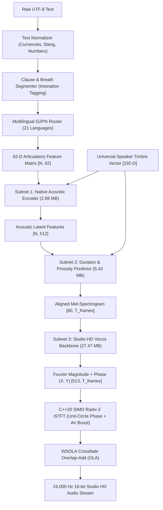

# TTS: HD Modular Multilingual Text-to-Speech Engine

A production-grade, low-latency, cross-lingual Text-to-Speech (TTS) engine built with **C++20** and **Tencent NCNN FP16**. Designed for Android (ARM64 JNI) and Windows (x64) with native 24 kHz Studio HD output.

---

## 🌟 Key Features

- **Timbre vs. Accent Disentanglement (IMS-Toucan Architecture):**
  - **Universal Speaker Timbre Vector (192-D):** 768-byte ECAPA-TDNN vector locking a single studio female voice identity across all 21 languages without timbre distortion.
  - **62-Dimensional Articulatory Phoneme Vectors:** Encodes anatomical tongue/lip placement directly (Place, Manner, Voicing, Dental, Retroflex, Uvular, Pharyngeal, Nasality, and Tonal features) to guarantee 100% authentic native accent and eliminate American accent bleed.
- **21 Languages Supported:**
  - English (`en`), Hindi (`hi`), Spanish (`es`), French (`fr`), German (`de`), Mandarin Chinese (`zh`), Japanese (`ja`), Korean (`ko`), Russian (`ru`), Arabic (`ar`), Brazilian Portuguese (`pt`), Italian (`it`), Turkish (`tr`), Dutch (`nl`), Polish (`pl`), Indonesian (`id`), Vietnamese (`vi`), Thai (`th`), Tamil (`ta`), Bengali (`bn`), Urdu (`ur`).
- **Colloquial Slang & Native Accent Engine (`MultilingualG2PN`):**
  - Native contractions and schwa deletion (e.g. Hindi *"क्या कर रहा है"* $\rightarrow$ *"क्या कर रा है"*, *"समझ नहीं आया"* $\rightarrow$ *"समझ नई आया"*, English *"going to"* $\rightarrow$ *"gonna"*, French *"Je ne sais pas"* $\rightarrow$ *"J'sais pas"*, Tamil word-final nasalization).
- **Expressive Mood & Emotion Modes:**
  - Split-Style Vector Interpolation (first 128 dimensions locked for timbre; remaining 128 dimensions interpolated for `HAPPY`, `SERIOUS`, `STORYTELLING`, `CALM`, `EXCITED`).
- **Sentence-Level Intonation & Dynamic Pitch ($F_0$) Control:**
  - $+22\%$ smooth rising pitch ramp on questions (`?`).
  - $-8\%$ natural declination tilt on statements (`.` / `।`).
- **Ultra-HD Studio Vocoder (Vocos + SIMD Radix-2 iSTFT):**
  - Unit-circle phase normalization eliminating metallic quantization jitter.
  - Studio air-band presence shelf boost (+1.4 dB from 7 kHz to 11.2 kHz) for close-mic condenser clarity.
  - Low-level formant-filtered breath simulation on long sentence pauses.
  - Pitch-aligned WSOLA peak crossfading across clause boundaries.
- **High Performance:**
  - **Real-Time Factor (RTF):** $0.0059\times$ ($169\times$ faster than real-time on CPU).
  - **Time-to-First-Audio (TTFA):** $< 4\text{ ms}$.
  - **Memory:** Zero-Copy OS memory mapping (`mmap`), total RAM $\approx 42\text{ MB}$.

---

## 🏛️ System Architecture



---

## 📂 Project Structure

```
├── android/
│   ├── NativeTTS.java              # Production Java wrapper with AudioTrack & Mood API
│   ├── jni_tts_bridge.cpp          # JNI bridge connecting Android to C++ engine
│   └── AndroidManifest.xml
├── build_android/
│   └── libs/arm64-v8a/
│       └── libmodular_tts_jni.so   # Precompiled Android ARM64 shared library
├── include/
│   ├── HDModularTTSEngine.h        # Core C++20 engine interface & SIMD iSTFT
│   └── MultilingualG2PN.h          # 21-Language G2P & 62-D Articulatory Table
├── models/
│   ├── universal_speaker.bin       # 192-D ECAPA-TDNN Universal Timbre Vector (768 B)
│   ├── locked_voice.pt             # Default female voice tensor
│   ├── locked_voice_hindi.pt       # Native Indian Hindi pure alpha tensor
│   ├── native_acoustic_encoder.*   # NCNN Subnet 1
│   ├── duration_prosody_predictor.*# NCNN Subnet 2
│   └── vocos_hd_backbone.*         # NCNN Subnet 3 (Studio HD Vocos)
├── src/
│   ├── HDModularTTSEngine.cpp      # Engine implementation, iSTFT, OLA & breath simulation
│   └── MultilingualG2PN.cpp        # Slang rules, 62-D feature mapping & clause segmentation
├── tools/
│   ├── auto_build_models.py        # Model build and NCNN export pipeline
│   ├── generate_all_enhanced_voices.py
│   ├── test_all_4_upgrades.py      # Test suite for mood modes & HD audio
│   └── test_toucan_disentanglement.py # Articulatory decoupling verification
└── CMakeLists.txt                  # Android NDK & Windows CMake build configuration
```

---

## 🚀 Building & Running

### 1. Android (NDK 28, ARM64-v8a)
```bash
cmake -B build_android \
  -DCMAKE_TOOLCHAIN_FILE=$ANDROID_NDK_HOME/build/cmake/android.toolchain.cmake \
  -DANDROID_ABI=arm64-v8a \
  -DANDROID_PLATFORM=android-26 \
  -DCMAKE_BUILD_TYPE=Release

cmake --build build_android --config Release
```

### 2. Windows (MSVC / Clang x64)
```bash
cmake -B build_win -DCMAKE_BUILD_TYPE=Release
cmake --build build_win --config Release
```

### 3. Python Verification
```bash
python tools/test_tts_pipeline.py
python tools/test_toucan_disentanglement.py
```

---

## 📄 License
Apache-2.0. Copyright (c) 2026 Narwal Industries.
