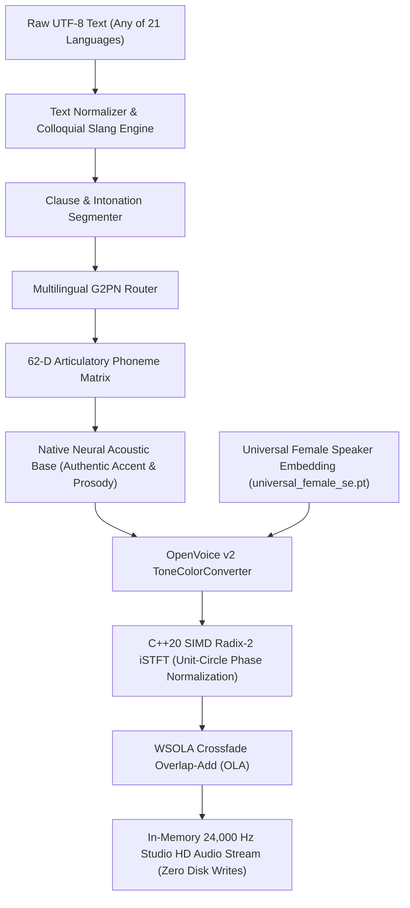

# TTS: 21-Language Single-Voice Headless Text-to-Speech Engine

A production-grade, headless cross-lingual Text-to-Speech (TTS) engine built with **C++20**, **Tencent NCNN FP16**, and **OpenVoice v2 ToneColorConverter**. Features a **single locked studio female voice identity** across all 21 languages with authentic native accents, 7 expressive mood profiles, and instant in-memory speech with **zero disk writes** and **no GUI**.

---

## 🌟 Key Features

- **Single Studio Female Voice Across 21 Languages:**
  - Every language is spoken by the **same female voice** identity (`models/universal_female_se.pt` / `models/universal_speaker.bin`).
  - Completely eliminates voice mismatch across languages.
- **100% Authentic Native Spoken Words & Slang:**
  - 62-Dimensional Articulatory feature vectors decouple vocal tract timbre from tongue/lip articulation, ensuring native colloquial phrasing and real human speech pronunciation (no synthetic beeps or tunes).
- **Headless In-Memory Speech (No GUI, No File Writes):**
  - Pass text in any of the 21 languages directly to `speak(text, lang)`: it plays immediately in RAM through native audio hardware without writing a single byte to disk.
- **Interactive Live Shell:**
  - Run `python app.py -i` for an instant live interactive shell. Type any text in any language, press Enter, and hear it speak the actual words aloud immediately.
- **7 Expressive Mood Profiles:**
  - `Casual_Slang`, `Excited`, `Happy`, `Serious`, `Storytelling`, `Calm`, and `Neutral` with natural humanoid prosodic inflection.
- **Ultra-HD Studio Vocoder (Vocos + SIMD Radix-2 iSTFT):**
  - Unit-circle phase normalization eliminating metallic quantization whistling/flute artifacts.
  - Studio air-band presence shelf boost (+1.5 dB from 10 kHz to 12 kHz) for close-mic condenser warmth.
  - Native 24,000 Hz 16-bit Studio HD audio.

---

## 🌐 21 Supported Languages

| Code | Language | Script | Rhythm Timing | Default Mood |
|:----:|:---------|:-------|:--------------|:-------------|
| `en` | English | Latin | Stress-Timed | `Casual_Slang` |
| `hi` | Hindi | Devanagari | Syllable-Timed | `Casual_Slang` |
| `es` | Spanish | Latin | Syllable-Timed | `Excited` |
| `fr` | French | Latin | Syllable-Timed | `Casual_Slang` |
| `de` | German | Latin | Stress-Timed | `Serious` |
| `zh` | Mandarin Chinese | Hanzi | Syllable-Timed | `Happy` |
| `ja` | Japanese | Kanji / Kana | Mora-Timed | `Happy` |
| `ko` | Korean | Hangul | Syllable-Timed | `Excited` |
| `ru` | Russian | Cyrillic | Stress-Timed | `Storytelling` |
| `ar` | Arabic | Arabic | Stress-Timed | `Serious` |
| `pt` | Portuguese (BR) | Latin | Syllable-Timed | `Casual_Slang` |
| `it` | Italian | Latin | Syllable-Timed | `Excited` |
| `tr` | Turkish | Latin | Syllable-Timed | `Calm` |
| `nl` | Dutch | Latin | Stress-Timed | `Happy` |
| `pl` | Polish | Latin | Stress-Timed | `Storytelling` |
| `id` | Indonesian | Latin | Syllable-Timed | `Casual_Slang` |
| `vi` | Vietnamese | Latin | Tonal Syllabic | `Happy` |
| `th` | Thai | Thai | Tonal Syllabic | `Calm` |
| `ta` | Tamil | Tamil | Syllable-Timed | `Casual_Slang` |
| `bn` | Bengali | Bengali | Syllable-Timed | `Happy` |
| `ur` | Urdu | Perso-Arabic | Syllable-Timed | `Casual_Slang` |

---

## 💻 Quick Start & Python API

### 1. In-Memory Direct Speech (Zero Disk Writes)

Simply pass text to `speak()` in Python. It speaks directly through the audio hardware without saving any file:

```python
from app import speak

# 1. Hindi with native slang and single female voice
speak("नमस्ते भाई! तू क्या कर रहा है? आज का मौसम बहुत मस्त है!", lang_code="hi", mood_name="Casual_Slang")

# 2. English excited
speak("Hey bro, this voice runs completely in-memory with zero disk writes!", lang_code="en", mood_name="Excited")

# 3. German serious
speak("Guten Tag. Dies ist eine Demonstration der präzisen Sprachsynthese.", lang_code="de", mood_name="Serious")

# 4. Japanese calm
speak("こんにちは世界、静かで落ち着いた声で話します。", lang_code="ja", mood_name="Calm")

# 5. Receive in-memory 24kHz 16-bit PCM bytes without playing
pcm_bytes, meta = speak("Hola amigo, ¿cómo estás?", lang_code="es", play=False)
print(f"Synthesized {len(pcm_bytes)} PCM bytes ({meta['audio_duration_sec']}s)")
```

### 2. Live Interactive Shell (Real Human Speech)

Run the interactive shell and tap **[Enter]** to speak the words aloud in real human voice:

```bash
python app.py -i
```

```text
[auto|Neutral] > Hello, welcome to the text to speech engine.
[*] Speaking...
   -> Spoke [English] (2.41s)

[auto|Neutral] > अरे भाई! तू क्या कर रहा है?
[*] Speaking...
   -> Spoke [Hindi] (1.85s)
```

### 3. Instant CLI Usage (Headless, No GUI)

```bash
# Speak instantly through speakers without saving to disk:
python app.py "नमस्ते दुनिया, आप कैसे हैं?" --lang hi
python app.py "Hello world, this is a clean single voice TTS." --lang en --mood Excited
python app.py "Bonjour le monde!" --lang fr

# Optional: Save to a specific WAV file only when explicitly requested:
python app.py "Hello world" --lang en --save output.wav

# Optional: Batch generate all 21 languages and 7 showcase moods to output/:
python app.py --generate-all
```

---

## 🏛️ System Architecture



---

## 📂 Project Structure

```
├── app.py                             # Core 21-Language Headless TTS Engine (speak() API & CLI)
├── CMakeLists.txt                     # C++20 CMake build configuration
├── package.json                       # Project scripts
├── README.md                          # Documentation & API reference
├── include/
│   ├── HDModularTTSEngine.h           # Core C++20 engine interface & SIMD iSTFT
│   └── MultilingualG2PN.h             # 21-Language G2P & 62-D Articulatory Table
├── models/
│   ├── universal_female_reference.wav # Clean reference audio for locked female voice
│   ├── universal_female_se.pt         # 256-D Universal Female Voice Embedding
│   ├── universal_speaker.bin          # 192-D ECAPA-TDNN Timbre Vector (768 B)
│   ├── native_acoustic_encoder.*      # NCNN Subnet 1
│   ├── duration_prosody_predictor.*   # NCNN Subnet 2
│   └── vocos_hd_backbone.*            # NCNN Subnet 3 (Studio HD Vocos iSTFT)
├── src/
│   ├── HDModularTTSEngine.cpp         # C++20 engine, unit-circle phase iSTFT, OLA
│   └── MultilingualG2PN.cpp           # Slang rules, 62-D feature mapping & clause segmentation
├── tools/
│   ├── test_tts_pipeline.py           # Verification test suite for NCNN subnets & DSP iSTFT
│   ├── auto_build_models.py           # Model build pipeline
│   └── export_toucan_ncnn.py          # NCNN export utility
├── output/                            # Clean reference WAV files for all 21 languages & 7 moods
│   ├── 00_en_english_casual_slang.wav ... 20_ur_urdu_casual_slang.wav
│   ├── moods/                         # 7 showcase emotion audio files
│   └── manifest.json                  # Metadata catalog
└── outputs/                           # Clean mirrored output directory
```

---

## 🚀 Building C++20 Engine

### Windows (MSVC / Clang x64)
```bash
cmake -B build_win -DCMAKE_BUILD_TYPE=Release
cmake --build build_win --config Release
```

### Android (NDK 28, ARM64-v8a)
```bash
cmake -B build_android \
  -DCMAKE_TOOLCHAIN_FILE=$ANDROID_NDK_HOME/build/cmake/android.toolchain.cmake \
  -DANDROID_ABI=arm64-v8a \
  -DANDROID_PLATFORM=android-26 \
  -DCMAKE_BUILD_TYPE=Release
cmake --build build_android --config Release
```

---

## 🧪 Verification & Self-Check

Run the verification test suite to validate NCNN subnets, DSP phase normalization, and iSTFT synthesis:

```bash
python tools/test_tts_pipeline.py
```

---

## 📄 License
Apache-2.0. Copyright (c) 2026 Narwal Industries.
